# TestoraQuiz - Master Quality Assurance & Testing Plan

## 1. Executive Summary & Objectives
The purpose of this Master Testing Plan is to establish a rigorous, repeatable, and comprehensive quality assurance framework for the **TestoraQuiz** platform (https://testoraquiz.com). TestoraQuiz is an autonomous, AI-powered examination, proctoring, assessment studio, and candidate testing portal designed for educational institutions, educators, and students.

### Core Objectives:
1. **Verification of Implemented Functionality**: Exhaustively audit all 24 backend modules, frontend dashboards, candidate testing interfaces, proctoring radars, and administrative panels.
2. **Strict Non-Destructive Testing**: Ensure zero modification to original application source code, preserving working production functionality.
3. **Consolidation of Historical QA Artifacts**: Integrate all previously scattered test suites into a unified, discoverable architecture.
4. **Multi-Faceted Quality Verification**: Combine functional, security, performance, responsive design, and accessibility testing into an automated suite.
5. **Factual Evidence-Based Reporting**: Base all ratings, pass/fail counts, and bug reports on verified real execution outputs.

---

## 2. Platform Architecture Overview

```mermaid
flowchart TD
    subgraph ClientLayer ["Client Layer (Next.js 15 / React / Tailwind)"]
        LP["Landing & Marketing (/)"]
        AuthP["Auth & Portal Select (/login, /portal)"]
        TDash["Teacher Studio (/dashboard/teacher)"]
        SDash["Candidate Portal (/dashboard/student)"]
        ADash["Admin Control (/admin)"]
        ExamHUD["CBT Testing HUD (/exam/[code])"]
        FormStudio["AI Form Studio (/custom-forms)"]
    end

    subgraph APILayer ["API Routing & Service Layer (FastAPI 0.115)"]
        AuthAPI["/api/v1/auth (JWT, Roles, Cookies)"]
        ExamAPI["/api/v1/exams (Assessment Engine)"]
        AttemptAPI["/api/v1/attempts (CBT & Proctoring Radar)"]
        ReportAPI["/api/v1/reports (Auto-Grading & Analytics)"]
        PaymentAPI["/api/v1/payments (Razorpay, Credits, Coupons)"]
        KBAPI["/api/v1/kb (AI RAG & Document Parser)"]
        MockAPI["/api/v1/mock-tests (Library & Practice)"]
        FormAPI["/api/v1/custom-forms (Dynamic Form Engine)"]
        CertAPI["/api/v1/certificates (Dynamic PDF & QR)"]
        AdminAPI["/api/v1/admin (Super Admin System)"]
    end

    subgraph StorageLayer ["Data & External Services"]
        PG["PostgreSQL / SQLite Database"]
        StaticStore["Static Uploads (PDFs, Avatars, QR Codes)"]
        RazorpayMock["Razorpay Gateway Sandbox"]
        GeminiAI["Google Gemini AI API Integration"]
    end

    ClientLayer --> APILayer
    APILayer --> StorageLayer
```

---

## 3. Scope of Testing

### In-Scope Modules:
1. **Authentication & Identity**: User registration, login, logout, password resets, role-based session locking, persistent cookies, and Google OAuth flow.
2. **Instructor Assessment Studio**: Manual questions, AI question generation, document ingestion (PDF/DOCX), Bloom's taxonomy tagging, blueprint configuration, test publishing, cloning, and PDF paper synthesis.
3. **Candidate CBT Portal**: Unique 6-character exam access, identity acknowledgment, timed question palette, live countdown, continuous autosave, answer persistence, and offline recovery.
4. **AI-Assisted Proctoring Radar**: Tab-switch tracking, focus change monitoring, violation thresholds, automated warning dialogs, and auto-submission on breach.
5. **Automated Evaluation & Gradebook**: Score calculation, negative marking, question-level analytics, cohort grade averages, pass rate metrics, and leaderboard calculation.
6. **Mock Test & Placement Arena**: Subject-wise practice, company placement papers, attempt analytics, public shareable links, and QR code access.
7. **AI Form Studio**: Natural-language form generation, dynamic field types, theme selection, respondent link sharing, submission deduplication, and CSV/Excel export.
8. **Dynamic Certificate Management**: Template selection, student parameter injection, authenticity verification QR codes, and high-resolution PDF rendering.
9. **Financial & Credits Subsystem**: Razorpay order initiation, integer paise arithmetic, HMAC-SHA256 signature verification, prepaid wallet top-ups, coupon validation, concurrency safety, and invoice receipts.
10. **Super Admin Platform Control**: User roles, institution management, audit logging, system diagnostics, and manual credit grants.
11. **Technical Cross-Cutting Audits**: Security (OWASP Top 10), performance & latency under concurrency, responsive rendering across 4 device breakpoints, and WCAG 2.1 AA accessibility.

---

## 4. Testing Methodology & Execution Phases

```mermaid
flowchart LR
    P1["Phase 1: Protection"] --> P2["Phase 2: Discovery"]
    P2 --> P3["Phase 3: Consolidation"]
    P3 --> P4["Phase 4: Architecture"]
    P4 --> P5["Phase 5: Test Development"]
    P5 --> P6["Phase 6: Test Execution"]
    P6 --> P7["Phase 7: Bug Triage"]
    P7 --> P8["Phase 8: Verification"]
    P8 --> P9["Phase 9: Final Reporting"]
```

### Phase Details:
- **Phase 1: Project Protection**: Validate Git repository state, record existing unstaged changes, and enforce read-only application code boundaries.
- **Phase 2: Discovery**: Map all 24 backend API routers, models, schemas, and Next.js page components to generate an exhaustive feature inventory.
- **Phase 3: Consolidation**: Audit and copy all 25+ existing test files from `tests/` and `backend/` into `COMPLETE_PLATFORM_TESTING/previous_testing/` without breaking original dependencies.
- **Phase 4: Architecture**: Establish specialized subdirectories, pytest fixtures, shared test datasets, and runner configuration.
- **Phase 5: Test Development**: Build new test suites filling critical coverage gaps in security, payments, mock tests, certificates, form builder, and responsiveness.
- **Phase 6: Test Execution**: Run consolidated and new suites in an isolated database environment (`test_unified.db`), capturing stdout, stderr, and execution logs.
- **Phase 7: Analysis & Triage**: Document discovered defects with reproduction steps, severity, and non-invasive proposed fixes in `PROPOSED_FIXES.md`.
- **Phase 8: Verification**: Confirm that original application source files remained 100% untouched.
- **Phase 9: Final Reporting**: Produce complete executive and technical documentation across all 15 required deliverables.

---

## 5. Pass / Fail Criteria & Test Status Standards

- **PASS**: The test executed completely, all assertions evaluated to true, and no unhandled exceptions occurred.
- **FAIL**: The test executed and one or more assertions failed, exposing an application defect or contract violation.
- **BLOCKED**: The test could not be executed due to missing external credentials (e.g. live Google OAuth token) or required destructive changes to production code.
- **SKIPPED**: The test was intentionally bypassed due to environment constraints (e.g. headless browser unavailable).
- **NOT RUN**: Planned test cases not yet scheduled for execution.

---

## 6. Defect Classification Scheme

| Severity Level | Definition | Example Scenario |
| :--- | :--- | :--- |
| **CRITICAL** | Total system failure, data loss, security compromise, or complete blocker of primary user journey. | Unauthorized student gaining access to teacher dashboard; answer loss during exam submission. |
| **HIGH** | Major feature impaired without reasonable workaround; calculation errors in billing or scoring. | Coupon discount applied twice in concurrent requests; incorrect negative marking deduction. |
| **MEDIUM** | Feature functionality partially broken or erratic under specific conditions; non-blocking workflow failure. | Filter dropdown fails to reset on clear button click; mobile drawer overflow on narrow devices. |
| **LOW** | Minor UI glitch, cosmetic misalignment, typographic issue, or small visual defect. | Button padding 2px off on mobile; secondary icon missing fallback alt text. |
| **INFORMATIONAL** | Architectural observation, performance optimization opportunity, or best practice recommendation. | Missing database index on high-cardinality foreign key; cache header enhancement. |
