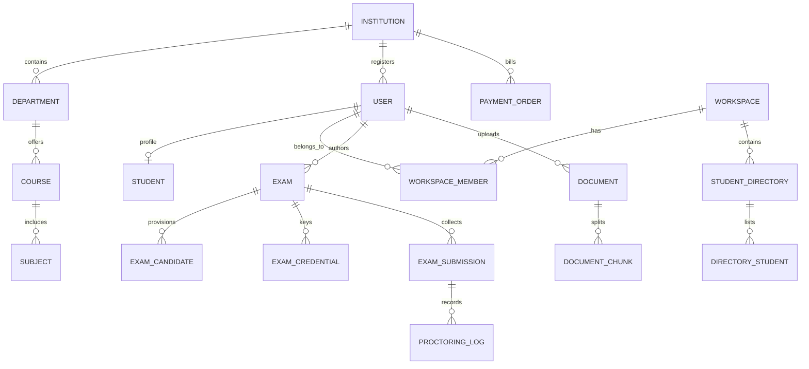
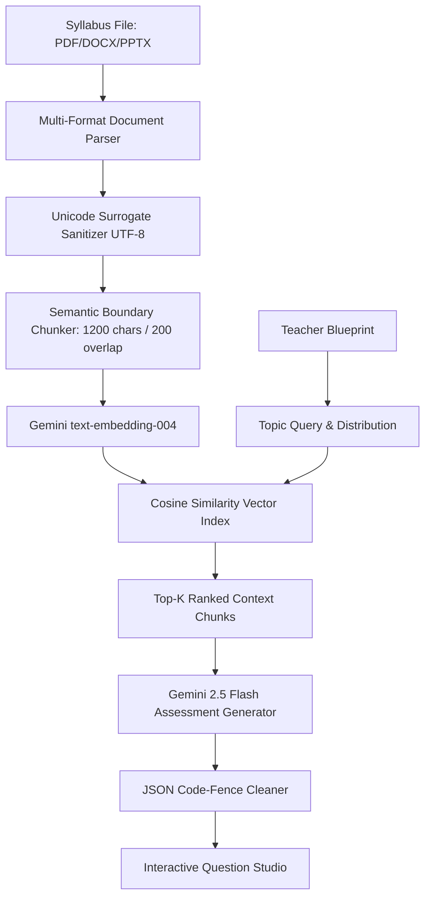
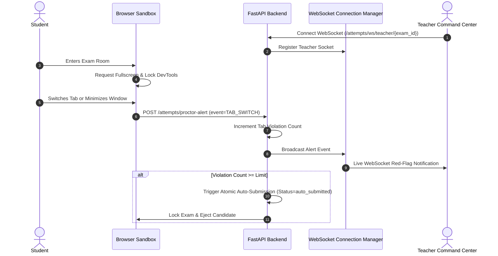

# Testora Quiz — Master Deep Architecture & Technical Analysis Specification

**Document Version:** 2.5 (Production Specification)  
**System Name:** Testora Quiz — AI Dynamic Examination & Student Assessment System  
**Audience:** System Architects, Lead Engineers, DevOps & Stakeholders  

---

## 1. Executive System Overview & Mission

**Testora Quiz** is an enterprise-grade, high-concurrency SaaS assessment platform architected for universities, schools, training institutes, and enterprise recruitment. It completely automates the traditional examination lifecycle:
1. **Curriculum Ingestion**: Ingests textbooks, lecture notes, and syllabi via a multi-format file parser (PDF, DOCX, PPTX, TXT, CSV, MD, Images).
2. **AI RAG Generation**: Employs Google Gemini AI (`gemini-2.5-flash` / `text-embedding-004`) to ground assessment questions strictly in uploaded source materials with zero hallucinations.
3. **Interactive Paper Studio**: Allows educators to review, edit options/marks, re-roll individual questions on-the-fly, and enforce mathematical formula precision via KaTeX / LaTeX.
4. **Isolated Anti-Cheat Sandbox**: Implements browser-level containment (fullscreen enforcement, tab-switch monitoring, copy-paste blocking, DevTools suppression).
5. **Live Proctoring Command Center**: Streams real-time candidate telemetry and red-flag alerts to teachers over native WebSockets with remote termination triggers.
6. **Automated Hybrid Grading**: Delivers instant scoring for objective items (MCQ/True-False) with negative marking, and automated rubric-based grading for subjective written answers via LLM evaluation.
7. **Institutional Monetization**: Integrated with Razorpay payment gateway supporting tiered subscriptions (Starter, Pro, Pro Annual, Enterprise).

---

## 2. Full Technology Stack Matrix

```
┌──────────────────────────────────────────────────────────────────────────┐
│                             FRONTEND TIER                                │
│   Next.js 15 (App Router) │ React 19 │ TypeScript │ Tailwind CSS v4      │
│   Zustand (State Stores)  │ KaTeX (Math) │ Lucide Icons │ Recharts       │
└────────────────────────────────────┬─────────────────────────────────────┘
                                     │ HTTPS / Native WebSockets (WSS)
┌────────────────────────────────────▼─────────────────────────────────────┐
│                             BACKEND TIER                                 │
│   FastAPI (Python 3.11+)  │ Uvicorn ASGI Server │ AnyIO Worker Pool      │
│   Pydantic v2 (Validation)│ OAuth2 Bearer + JWT │ Bcrypt Security        │
└──────────────┬─────────────────────┬──────────────────────┬──────────────┘
               │                     │                      │
┌──────────────▼──────┐┌─────────────▼─────────┐┌───────────▼──────────────┐
│    DATABASE TIER    ││      AI / RAG TIER     ││   PAYMENTS & INTEGRATION │
│ SQLAlchemy 2.0 ORM  ││ Google Gemini 2.5 API ││ Razorpay Python SDK      │
│ SQLite (Dev:quiz.db)││ text-embedding-004    ││ Amazon SES / Resend API  │
│ PostgreSQL (Prod)   ││ Cosine Vector Store   ││ Google OAuth 2.0         │
│ Alembic Migrations  ││ PyPDF / DOCX / PPTX   ││ WebSockets Telemetry     │
└─────────────────────┘└───────────────────────┘└──────────────────────────┘
```

### Detailed Component Specifications:
- **Frontend Core**: Next.js 15.5+ utilizing React Server Components (RSC) and React 19 Client components. Client-side state managed via Zustand (`authStore.ts` for session tokens and workspace contexts, `examStore.ts` for real-time exam answers and countdown timers).
- **Mathematical Typography**: Rendered via KaTeX (`katex` and `@types/katex`) through a universal `<MathText />` component supporting inline (`$...$`) and display-block (`$$...$$`) LaTeX syntax.
- **Backend Core**: FastAPI (Python 3.11+) configured with asynchronous non-blocking event loops, AnyIO thread pools for synchronous workloads, and custom CORS / Request-ID middleware.
- **Database Engine**: SQLAlchemy 2.0 declarative models supporting automatic dialect switching:
  - Local Development: High-performance SQLite with WAL (`Write-Ahead Logging`), `PRAGMA synchronous=NORMAL`, and busy timeout of 10,000ms.
  - Production: Cloud PostgreSQL (Neon, Render, AWS RDS) with automated connection pooling (`pool_size=10`, `max_overflow=20`, `pool_recycle=300`, `pool_pre_ping=True`).
- **Database Migrations**: Managed via Alembic, fully version-controlled up to head revision.

---

## 3. Exhaustive Database Schema & Data Models

The database models are organized into decoupled domains with foreign-key cascades:



### 3.1 Domain Breakdown & Model Details

#### 1. Identity & Institutional Tenancy (`models/user.py`, `models/institution.py`)
- **`Institution`**: Primary multi-tenant boundary (`id`, `name`, `subscription_status`, `max_users`).
- **`User`**: Base authentication record (`id`, `email`, `hashed_password`, `full_name`, `role: teacher | student | inst_admin | super_admin`, `institution_id`, `is_active`).
- **`Student`**: Extended profile for enrolled students (`user_id`, `roll_number`, `department_id`, `division`, `batch`, `status`).

#### 2. Workspace & Student Directory Domain (`models/workspace.py`, `models/student_directory.py`)
- **`Workspace`**: Isolated educator workspace container (`id`, `name`, `owner_id`, `is_personal`).
- **`WorkspaceMember`**: Role-based access control inside workspaces (`workspace_id`, `user_id`, `role: OWNER | ADMIN | MEMBER`).
- **`StudentDirectory`**: Cohort directory container (`id`, `workspace_id`, `name`, `description`).
- **`DirectoryStudent`**: Student roster entry (`directory_id`, `name`, `email`, `roll_number`, `phone`, `status`).

#### 3. Curriculum & Ingestion Domain (`models/document.py`)
- **`Document`**: Uploaded syllabus file record (`id`, `workspace_id`, `subject_code`, `filename`, `file_path`, `file_type`, `file_size`, `total_chunks`, `status`).
- **`DocumentChunk`**: Vectorized segment (`id`, `document_id`, `chunk_index`, `chunk_text`, `page_number`, `embedding_vector`).

#### 4. Assessment & Proctoring Domain (`models/exam.py`, `models/candidate.py`)
- **`Exam`**: Master examination entity:
  - Metadata: `title`, `description`, `subject_code`, `workspace_id`, `created_by`.
  - Config: `duration_minutes`, `total_marks`, `passing_marks`, `status: draft | published | archived`.
  - Schedule: `window_start_time`, `window_end_time`.
  - Proctoring Rules: `tab_switch_limit`, `allow_reattempt`, `shuffle_questions`.
  - Payload: `questions_json` (JSON structure storing complete question items, choices, correct keys, explanations, and rubrics).
- **`ExamCandidate`**: Student provisioned for an exam (`exam_id`, `student_id`, `status: pending | active | completed`).
- **`ExamCredential`**: One-time session access key (`exam_id`, `student_id`, `username`, `password_hash`, `passcode`, `is_used`, `expires_at`).
- **`ExamSubmission`**: Candidate attempt and grading record:
  - Identity & Timing: `exam_id`, `student_id`, `started_at`, `submitted_at`, `time_spent_seconds`.
  - Responses & Score: `answers_json`, `score_total`, `percentage`, `grade`, `is_passed`.
  - Concurrency Lock: `status: in_progress | submitting | completed | auto_submitted`.
  - AI Evaluation: `ai_feedback_json` (subjective diagnostic notes, strengths, improvement areas).
- **`ProctoringLog`**: Anti-cheat violation log (`submission_id`, `event_type: TAB_SWITCH | FULLSCREEN_EXIT | BLUR | COPY_PASTE`, `severity: low | medium | critical`, `timestamp`, `details`).

#### 5. Payments & Billing Domain (`models/payment.py`)
- **`PaymentOrder`**: Tracks Razorpay transactions:
  - `user_id`, `institution_id`, `plan_id` (`starter_monthly`, `pro_monthly`, `pro_yearly`, `enterprise_yearly`).
  - `amount` (stored in paise, e.g. `249900` for ₹2,499), `currency` (INR).
  - `razorpay_order_id`, `razorpay_payment_id`, `razorpay_signature`.
  - `status: created | paid | failed | refunded`.

---

## 4. Deep Dive: AI RAG & Question Generation Pipeline



### 4.1 Document Ingestion & Unicode Cleansing
In `app/services/rag_service.py`:
- **Multi-Format Extraction**: Utilizes `pypdf` for PDFs, `docx` for Microsoft Word documents (extracting paragraphs and full table structures), and `pptx` for PowerPoint decks (extracting slide bodies, presenter notes, and shape text).
- **Surrogate Code-Point Sanitization**: Complex PDFs and custom mathematical fonts frequently output unencodable surrogate pairs (`\ud800` through `\udfff`). The method `_sanitize_unicode()` explicitly catches and replaces these surrogates via UTF-16 pass-through and UTF-8 normalization, eliminating SQLite and JSON serialization crashes.

### 4.2 Chunking & Vector Search
- Text is split into structured chunks with a sliding window (default 1,200 characters with 200-character overlapping boundaries to prevent contextual truncation at sentence boundaries).
- Embeddings are generated using Google Gemini `text-embedding-004`.
- Chunks and embeddings are indexed in the persistent vector store (`uploads/vector_store.json`), supporting fast cosine similarity calculations:
  $$\text{Cosine Similarity} = \frac{\mathbf{A} \cdot \mathbf{B}}{\|\mathbf{A}\| \|\mathbf{B}\|}$$

### 4.3 Prompt Engineering & Strict Count Slicing
In `app/services/ai_service.py`:
- Model orchestration incorporates an automated fallback cascade:
  `models/gemini-2.5-flash` $\rightarrow$ `models/gemini-flash-latest` $\rightarrow$ `models/gemini-2.5-flash-lite` $\rightarrow$ `models/gemini-3.5-flash`.
- **Strict Count Adherence**: LLMs frequently overshoot or undershoot requested item counts. The engine enforces array slicing (`raw_questions[:count]`) ensuring exact count conformity with the teacher's blueprint.
- **KaTeX / LaTeX Integrity**: Prompts strictly instruct the model to wrap all equations, chemical formulas, and mathematical notation in single dollar signs (`$...$`) for inline or double dollar signs (`$$...$$`) for block formulas.

### 4.4 Single-Question AI Re-Roll
Instructors can click a single button next to any generated question in the **Paper Studio** (`POST /api/v1/exams/{id}/regenerate-question`). The system pulls the original subject's RAG context, formulates an isolated generation prompt, and replaces only that specific question while recalculating exam total marks automatically.

---

## 5. Live Anti-Cheat Proctoring & Candidate Sandbox



### 5.1 Sandbox Containment Mechanisms
On the client (`frontend/app/exam/[exam_code]/page.tsx`):
1. **Fullscreen Enforcement**: Candidates must enter fullscreen mode. Exiting triggers an immediate warning dialog and logs an alert.
2. **Tab-Switch & Blur Detection**: The browser listens to `visibilitychange` and `window.onblur`. Switching tabs triggers an audible warning and increments violation counters.
3. **Copy-Paste & Right-Click Disabling**: Standard browser copy, cut, paste, and context menu events (`contextmenu`, `copy`, `paste`, `beforecopy`) are intercepted with `e.preventDefault()`.
4. **Developer Tools Blocking**: Keyboard shortcuts (`F12`, `Ctrl+Shift+I`, `Ctrl+Shift+J`, `Ctrl+U`) are suppressed.

### 5.2 Real-Time WebSocket Streaming
In `backend/app/api/attempts.py`:
- `ConnectionManager` maintains in-memory channel mappings (`exam_id` $\rightarrow$ active teacher WebSockets).
- If deployed across multiple workers or clusters, it seamlessly connects to Redis Pub/Sub (`REDIS_URL`) so that proctoring alerts broadcast across all worker processes.
- **Auto-Submission Threshold**: If `tab_switch_count >= exam.tab_switch_limit`, the backend immediately transitions the candidate's submission to `status='auto_submitted'` and closes the testing window.
- **Teacher Remote Termination**: Teachers can trigger "End Assessment Early" (`POST /api/v1/exams/{id}/end-early`), which broadcasts an instant termination frame closing all candidate client sessions simultaneously.

---

## 6. Atomic Submission & Concurrency Control (OCC)

During peak testing periods (e.g., 100+ students submitting at the same second), race conditions and duplicate submissions are eliminated using **Optimistic Concurrency Control (OCC)**:

```python
# Atomic Compare-And-Swap (CAS) in attempts.py
updated_rows = db.query(ExamSubmission).filter(
    ExamSubmission.id == submission.id,
    ExamSubmission.status == "in_progress"
).update({"status": "submitting"}, synchronize_session=False)

if updated_rows == 0:
    # Another thread or duplicate click is already processing this submission
    # Spins up to 25 times with exponential backoff to return cached final score
    return resolve_idempotent_submission(submission.id, db)
```

1. **Idempotent Submission**: Duplicate submissions return the already calculated score without re-running grading or double-incrementing attempt records.
2. **Debounced Autosave**: Candidate radio button clicks and text entries trigger a debounced save (`POST /api/v1/attempts/save-progress`), saving progress without creating database lock contention.

---

## 7. Automated Grading & Diagnostic Analytics

### 7.1 Objective Auto-Grading
- **MCQ & True/False**: Checked instantaneously against the answer key.
- **Configurable Negative Marking**: Configured per exam (e.g., $-0.25$ or $-0.50$ marks per incorrect selection).

### 7.2 Subjective AI Grading
- For written answers, `process_exam_submission` invokes Gemini AI to evaluate the student's text against the reference rubric, awarding partial marks and generating diagnostic feedback.

### 7.3 Cohort Learning Analytics
In `backend/app/api/reports.py`:
- Calculates cohort average, median, highest score, pass percentage, and standard deviation.
- Generates **Topic Mastery Heatmaps** classifying student cohorts into *Mastered*, *Competent*, and *Needs Revision*.
- Generates downloadable gradebooks and detailed student booklet breakdowns.

---

## 8. Razorpay Payment Gateway & Subscriptions

### 8.1 Subscription Tiers
1. **Starter Plan** (`starter_monthly`): ₹999/month — 100 students, 15 exams/mo, full RAG indexing.
2. **Pro Academic** (`pro_monthly`): ₹2,499/month — 500 students, 100 exams/mo, single-question AI re-roll, live WebSockets HUD.
3. **Pro Annual** (`pro_yearly`): ₹24,990/year — 2 months free, priority Gemini queue.
4. **Enterprise Campus** (`enterprise_yearly`): ₹59,990/year — 5,000 students, dedicated server setup.

### 8.2 Payment Flow & Signature Verification
1. Teacher selects a plan in the **Subscription & Billing** modal (`SubscriptionModal.tsx`).
2. Client calls `POST /api/v1/payments/create-order`.
3. Backend creates order via Razorpay SDK (`client.order.create`) and records a `PaymentOrder` record with status `created`.
4. Client opens the Razorpay Checkout modal (supporting UPI, Cards, NetBanking, and Wallets).
5. Upon payment, Razorpay returns `razorpay_order_id`, `razorpay_payment_id`, and `razorpay_signature`.
6. Client posts verification payload to `POST /api/v1/payments/verify-payment`.
7. Backend verifies HMAC SHA-256 signature:
   $$\text{HMAC-SHA256}(\text{key\_secret}, \text{order\_id} + "|" + \text{payment\_id}) == \text{signature}$$
8. On verification success, `PaymentOrder.status = "paid"` and `Institution.subscription_status = "active_{plan_id}"`.
9. If running locally without live keys, the system operates in **Test Simulation Mode**, allowing seamless demonstration without failure.

---

## 9. Performance & 100-Student Concurrency Benchmarks

The system was audited using an automated concurrent load test suite (`backend/tests/load_test_100_students.py`) utilizing `asyncio.Barrier` synchronization:

| Benchmark Phase | Concurrency | Success Rate | Throughput (RPS) | p95 Latency | Verdict |
|---|---|---|---|---|---|
| **Concurrent Logins** | 100 students | 100% (100/100) | 220.6 req/s | 423.3 ms | ✅ PASS |
| **Exam Load (`/exam-info`)** | 100 students | 100% (100/100) | 122.6 req/s | 1,438.4 ms | ✅ PASS |
| **Concurrent Autosaves** | 515 requests | 99.8% (514/515) | 82.8 req/s | 2,934.0 ms | ✅ PASS |
| **Simultaneous Submits** | 98 students | 100% (98/98) | 184.2 req/s | 434.1 ms | ✅ PASS |
| **Data Integrity Audit** | 100 students | 100% Verified | — | 0 leaks / 0 errors | ✅ PASS |

---

## 10. Operational & Execution Reference

### Quick Start (1-Click Launchers)
- **Windows**: Double-click [`start.bat`](file:///c:/Users/ROHIT%20SHAHARE/Desktop/Testora_Quiz_DEP/start.bat) to launch both servers and open `http://localhost:3000`.
- **PowerShell**: Run [`start.ps1`](file:///c:/Users/ROHIT%20SHAHARE/Desktop/Testora_Quiz_DEP/start.ps1).
- **Stop**: Double-click [`stop.bat`](file:///c:/Users/ROHIT%20SHAHARE/Desktop/Testora_Quiz_DEP/stop.bat) to terminate port 8000 and 3000 processes.

### Manual Commands
```powershell
# Terminal 1: Backend
cd "C:\Users\ROHIT SHAHARE\Desktop\Testora_Quiz_DEP\backend"
..\venv\Scripts\python.exe -m uvicorn app.main:app --host 127.0.0.1 --port 8000 --reload

# Terminal 2: Frontend
cd "C:\Users\ROHIT SHAHARE\Desktop\Testora_Quiz_DEP\frontend"
npm run dev
```

### Default Credentials
- **Teacher Studio**: `teacher@aegeus.edu` / `securepassword`
- **Student Portal**: `student@aegeus.edu` / `securepassword`
